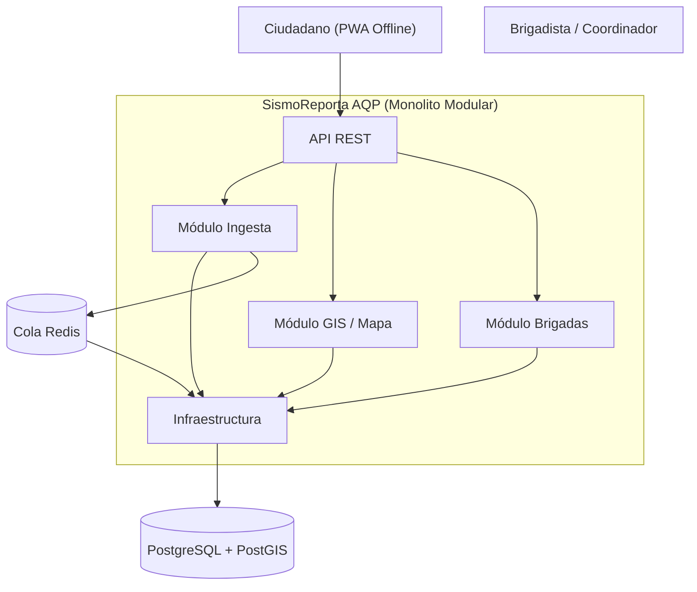
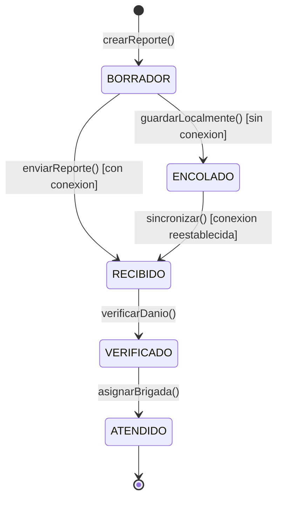

# SismoReporta AQP - Laboratorio 04 y 05: Arquitectura y Diseño UML

**Asignatura**: Construcción de Software (2026-B)  
**Escuela Profesional de Ingeniería de Sistemas - UNSA**

## Integrantes (Grupo XX)
| Nombre | Rol en el laboratorio |
|---|---|
| Adrian Viviano | Diagramador (Mermaid / PlantUML) |
| Adrian Viviano | Redactor de ADRs y drivers |
| Adrian Viviano | Verificador de IA y Script Python Diagrams |

## Caso Elegido: SismoReporta AQP
Plataforma de reporte ciudadano de daños tras un sismo en Arequipa para apoyar a Defensa Civil y brigadistas. Permite registrar reportes con foto y ubicación incluso sin señal de internet, visualizándolos en un mapa de calor priorizado por severidad.
- **Atributo Crítico**: Disponibilidad y resiliencia (20,000 reportes en la primera hora tras el sismo con red móvil congestionada; sincronización offline).

## Arquitectura Elegida

## Diseño UML (Lab 05) - SismoReporta AQP

### 1. Diagrama de Clases (E1)

* [Ver código fuente PlantUML](docs/design/clases.puml)

### 2. Diagrama de Secuencia - Sincronización Offline (E2)

* [Ver código fuente PlantUML](docs/design/secuencia-sincronizar-reporte.puml)

### 3. Máquina de Estados - Entidad Reporte (E3)

* [Ver código fuente Mermaid](docs/design/estados-reporte.mmd)
### 4. Diagrama de Actividades - Asignación de Brigadas (E4)

* [Ver código fuente PlantUML](docs/design/actividades-asignacion-brigadas.puml)
### 5. Diagrama de Paquetes - Coherencia ADR-001 (E5)

* [Ver código fuente PlantUML](docs/design/paquetes.puml)
**## Documentación de Soporte y Consistencia (E6 - E7)**
- **Historia de Usuario:** [HU-08 - Enviar y Sincronizar Reporte Offline](docs/design/historia.md)
- **Análisis Round-Trip:** [Informe de Ingeniería Directa e Inversa](docs/design/round-trip.md)
- **Reglas C1-C5:** [Auditoría de Consistencia de Diagramas](docs/design/consistencia.md)
- **Uso de IA:** [Bitácora de Interacciones y Prompts](docs/design/bitacora-ia.md)
- **Código Fuente:** [Esqueleto de Dominio en Python](src/reportes/dominio.py)    
