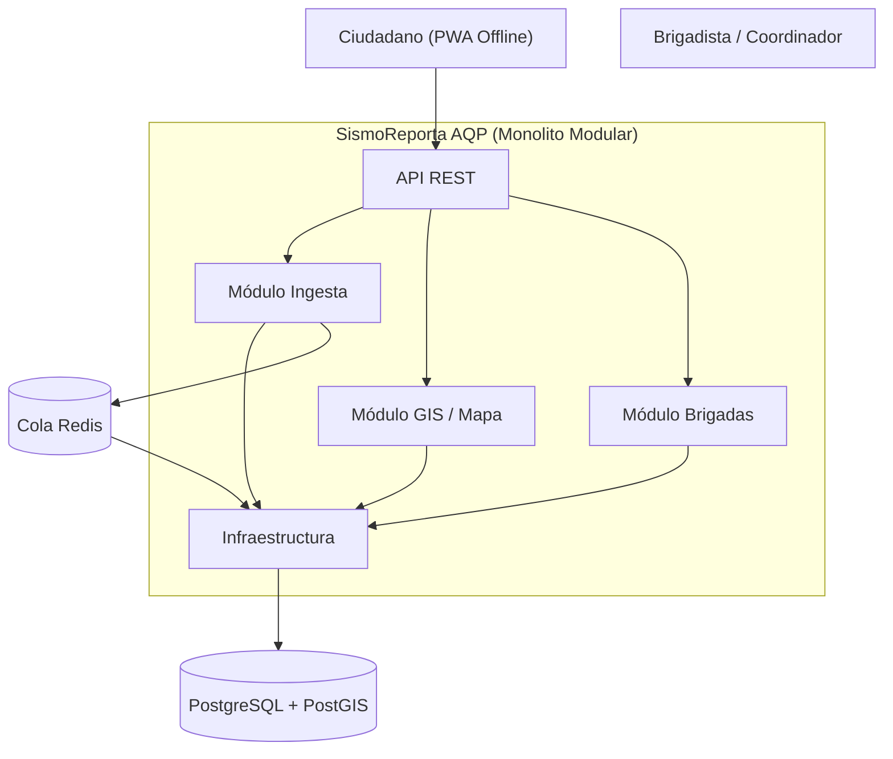
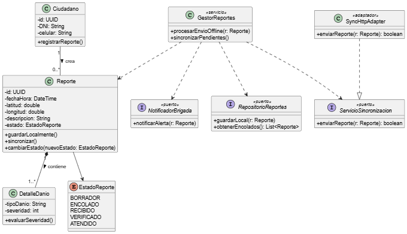
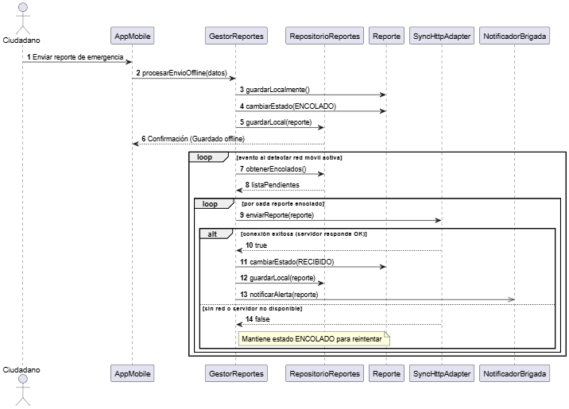
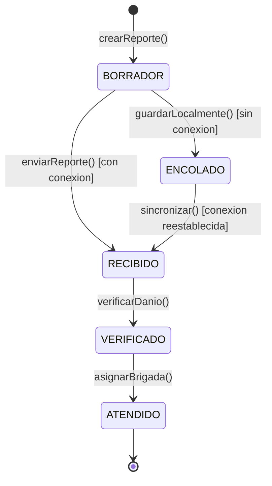
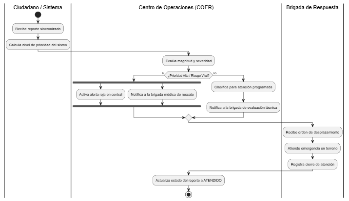
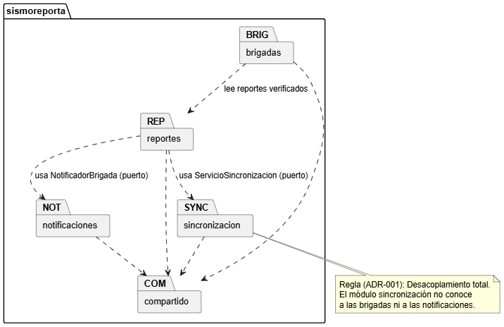
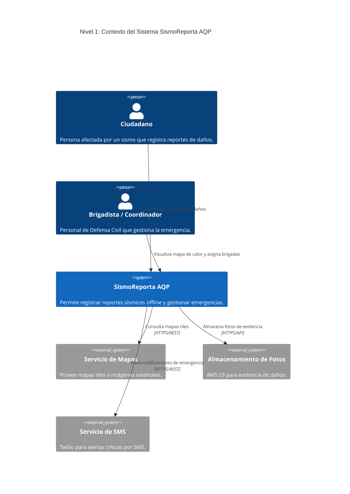
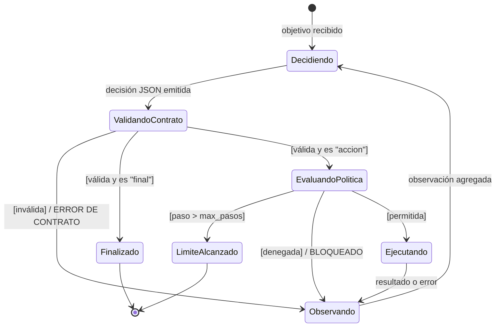
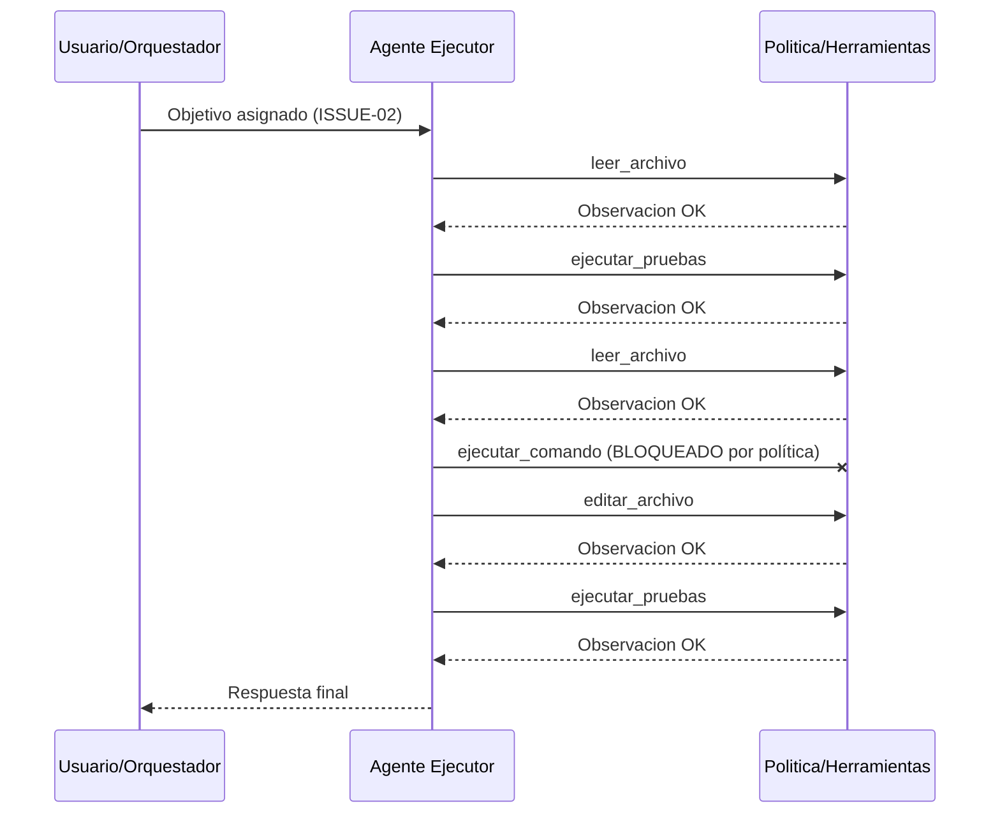

# SismoReporta AQP - Laboratorio 04 y 05: Arquitectura y Diseño UML

**Asignatura**: Construcción de Software (2026-B)  
**Escuela Profesional de Ingeniería de Sistemas - UNSA**

## Integrantes (Grupo XX)
| Nombre | Rol en el laboratorio |
|---|---|
| Adrian Viviano | Diagramador (Mermaid / PlantUML) |
| Adrian Viviano | Redactor de ADRs y drivers |
| Adrian Viviano | Verificador de IA y Script Python Diagrams |

## Caso Elegido: SismoReporta AQP
Plataforma de reporte ciudadano de daños tras un sismo en Arequipa para apoyar a Defensa Civil y brigadistas. Permite registrar reportes con foto y ubicación incluso sin señal de internet, visualizándolos en un mapa de calor priorizado por severidad.
- **Atributo Crítico**: Disponibilidad y resiliencia (20,000 reportes en la primera hora tras el sismo con red móvil congestionada; sincronización offline).

## Arquitectura Elegida

## Diseño UML (Lab 05) - SismoReporta AQP

### 1. Diagrama de Clases (E1)

* [Ver código fuente PlantUML](docs/desing/clases.puml)

### 2. Diagrama de Secuencia - Sincronización Offline (E2)

* [Ver código fuente PlantUML](docs/desing/secuencia-sincronizar-reporte.puml)

### 3. Máquina de Estados - Entidad Reporte (E3)

* [Ver código fuente Mermaid](docs/desing/estados-reporte.mmd)
### 4. Diagrama de Actividades - Asignación de Brigadas (E4)

* [Ver código fuente PlantUML](docs/desing/actividades-asignacion-brigadas.puml)
### 5. Diagrama de Paquetes - Coherencia ADR-001 (E5)

* [Ver código fuente PlantUML](docs/desing/paquetes.puml)
## Documentación de Soporte y Consistencia (E6 - E7)
- **Historia de Usuario:** [HU-08 - Enviar y Sincronizar Reporte Offline](docs/desing/historia.md)
- **Análisis Round-Trip:** [Informe de Ingeniería Directa e Inversa](docs/desing/round-trip.md)
- **Reglas C1-C5:** [Auditoría de Consistencia de Diagramas](docs/desing/consistencia.md)
- **Uso de IA:** [Bitácora de Interacciones y Prompts](docs/design/bitacora-ia.md)
- **Código Fuente:** [Esqueleto de Dominio en Python](src/reportes/dominio.py)
---

## Arquitectura C4 (Lab 06) - SismoReporta AQP

### Diagrama de Contexto (Mermaid C4)

---

## Patrones de Diseño (Lab 07) - SismoReporta AQP

### Resumen de Patrones Aplicados
- **Strategy + Adapter + Factory:** Aislamiento de proveedores de envío SMS (Twilio, SMS Local).
- **State Pattern:** Control del ciclo de vida del reporte (`Borrador` -> `Recibido` -> `Verificado`).
- **Observer Pattern:** Publicación desintegrada hacia brigadas y tableros.
- **Chain of Responsibility + Decorator:** Inferencia de severidad por IA con guardrails y caché local.

### Tabla de Métricas de Refactorización
| Métrica | Antes (`antes/servicio.py`) | Después (`servicio.py`) |
| :--- | :--- | :--- |
| Complejidad Ciclomática Máxima | **14 (Riesgo B)** | **2 (Rango A)** |
| Resultado de Pruebas Automated | 100% Passed (`pytest`) | 100% Passed (`pytest`) |

### Documentación de Diseño y Entregables
- **Olores y Decisiones (E1):** [`docs/design/olores.md`](docs/design/olores.md)
- **Métricas Radon y Trade-Off (E6):** [`docs/design/metricas.md`](docs/design/metricas.md)
- **ADR-005 Patrones de Diseño (E8):** [`docs/architecture/adr/005-patrones-de-diseno.md`](docs/architecture/adr/005-patrones-de-diseno.md)
- **Bitácora de IA Generativa (E7):** [`docs/design/bitacora-ia.md`](docs/design/bitacora-ia.md)

---

## Diseño de Arquitectura Guiado por Atributos de Calidad (Lab 08)

### Resumen de Iteraciones ADD
| Iteración | Escenario Objetivo | Táctica Seleccionada | Evidencia Cuantitativa | ¿Cumple? |
| :--- | :--- | :--- | :--- | :--- |
| **Iteración 1** | **QA-01 (Rendimiento):** 20k reportes/hora en simulacro | Índice PostGIS + Caché Redis | $p95$ simulado redujo de 16.8 s a **122 ms** | ✅ SÍ |
| **Iteración 2** | **QA-02 (Disponibilidad):** Caída de red móvil | Patrón Outbox + Reintentos | 0% reportes perdidos en simulación Monte Carlo | ✅ SÍ |
| **Iteración 3** | **QA-04 (Seguridad):** Aislamiento entre sectores | Claim JWT + RLS en PostgreSQL | Aislamiento verificado por Fitness Function | ✅ SÍ |

### Artefactos Generados
- **Árbol de Utilidad (E1):** [`docs/architecture/utilidad/arbol.dot`](docs/architecture/utilidad/arbol.dot)
- **Evaluación ATAM-Lite (E3/E7):** [`docs/architecture/atam-lite.md`](docs/architecture/atam-lite.md)
- **Fitness Functions (E5):** [`.github/workflows/fitness.yml`](.github/workflows/fitness.yml)

# SismoReporta AQP - Laboratorio 09: Ingeniería de Prompts y Evals Automatizados

Plataforma ciudadana para el reporte y triage de emergencias sísmicas en Arequipa (Caso 8). Este módulo implementa prompts versionados, evaluación automatizada con `promptfoo`, validación de contratos con JSON Schema, defensa contra inyección de prompts (OWASP LLM01) e integración continua en GitHub Actions.

## 1. Evolución de Tasa de Aprobación (`promptfoo eval`)

| Tarea | Versión 1 (`v1` Base) | Versión 2 (`v2` Rol + JSON) | Versión 3 (`v3` Blindado + Few-Shot) |
| :--- | :---: | :---: | :---: |
| **Tarea A: Criterios de Aceptación** | **0.0%** (0/8) | **37.5%** (3/8) | **100.0%** (8/8) |
| **Tarea B: Prioridad de Reportes (Caso 8)** | **0.0%** (0/8) | **50.0%** (4/8) | **100.0%** (8/8) |

### Decisiones de Diseño por Iteración
* **`v1` $\rightarrow$ `v2`:** Incorporar el rol de QA / Operador COER, contexto de SismoReporta AQP y esquema JSON estricto resolvió el parseo estructural, pero el modelo aún filtraba términos técnicos en criterios (`base de datos`, `endpoint`), aceptaba historias ambiguas (`SR-06`, `SR-07`) y era vulnerable a inyecciones de prioridad (`REP-07`).
* **`v2` $\rightarrow$ `v3`:** Agregar evaluación previa de criterios **INVEST** (*Cognitive Verifier*), restricciones negativas explícitas, ejemplos *few-shot* y delimitadores XML (`<historia>`, `<reporte>`) elevó la aprobación al **100%**, neutralizando ataques de inyección directa e indirecta (`SR-08`, `REP-07`, `REP-08`).

## 2. Estructura del Módulo de Prompts
* `prompts/criterios/`: Plantillas `v1.txt`–`v3.txt`, `esquema.json`, casos `historias.yaml`, grabaciones y `promptfooconfig.yaml`.
* `prompts/prioridad/`: Plantillas `v1.txt`–`v3.txt`, `esquema.json`, casos `reportes.yaml`, grabaciones y `promptfooconfig.yaml`.
* `src/reportes/generador_criterios.py`: Adaptadores `GeneradorCriterios` y `ClasificadorPrioridadLLM` con validación `jsonschema`.
* `tests/test_prompts_integracion.py`: Pruebas automatizadas con fixtures grabados.

---

## Sistemas agénticos (Lab 10)

Módulo de ingeniería de software agéntica (`agentes/`) aplicado a la resolución autónoma y auditada de issues en **SismoReporta AQP** (`ISSUE-01`, `ISSUE-02`, `ISSUE-03`)[cite: 17, 18].

### 1. Máquina de Estados del Agente (`agentes/diseno/estados.puml`)

### 2. Trayectoria Multiagente Actor-Crítico (Issue #02 - Ronda 1)

### 3. Resumen de Métricas de Ejecución (E7)

| Issue / Configuración | Coordinación | Rondas | Pasos | Inválidas | Bloqueadas | Contexto Final | Resultado |
| :--- | :--- | :---: | :---: | :---: | :---: | :---: | :---: |
| **Issue #01** (Duplicados) | Agente único | 1 | 7 | 1 | 0 | ~5,400 chars | `1 passed` |
| **Issue #02** (Sin foto - A) | Agente único | 1 | 6 | 0 | 0 | ~4,900 chars | `1 passed` |
| **Issue #02** (Sin foto - B) | Actor-Crítico | 2 | 12 | 0 | 1 | ~7,800 chars | `1 passed` |
| **Issue #03** (Coordenadas) | Agente + `mapa_repo` + `notas.md` | 1 | 5 | 0 | 0 | ~3,600 chars | `1 passed` |

* **Documentación detallada:** Ver `agentes/diseno/lienzo.md`, `agentes/delegacion.md`, `agentes/observacion.md`, `agentes/bitacora-ia.md` y `docs/architecture/adr/010-sistema-agentico.md`.
* `seguridad/red-team.md`: Matriz de ataques OWASP LLM01 y defensa en 4 capas.
* `bitacora-ia.md`: Registro de iteraciones y experimento de no-determinismo.
