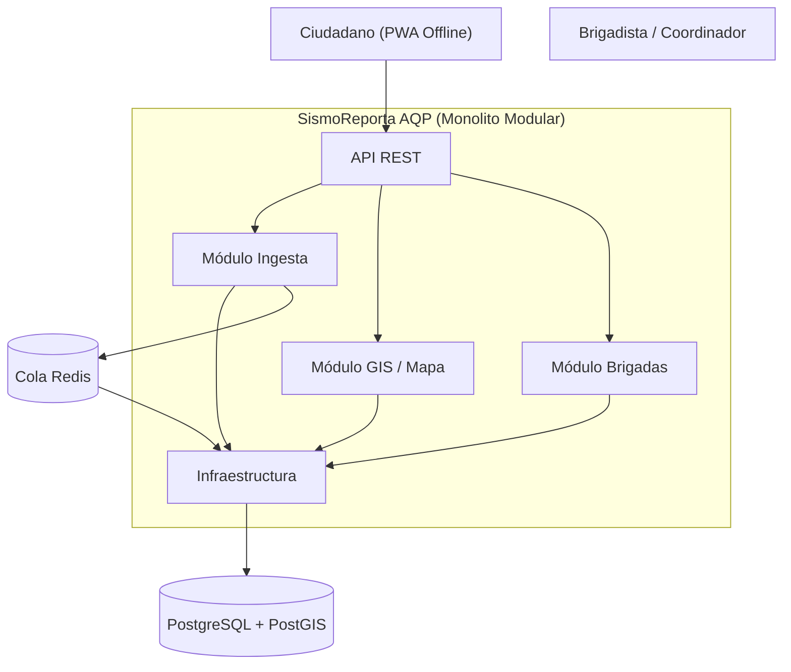
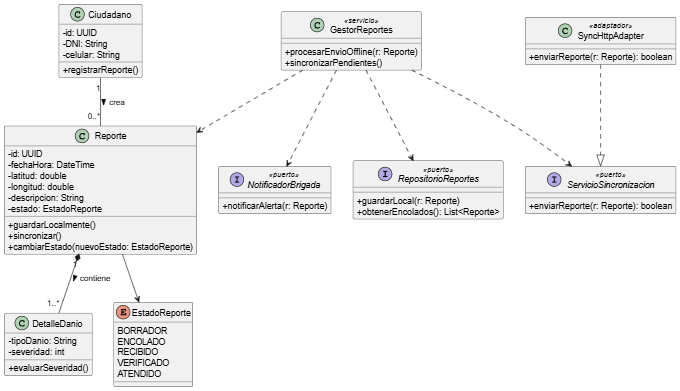
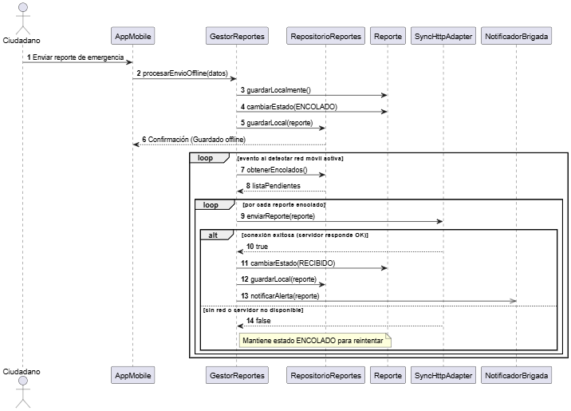
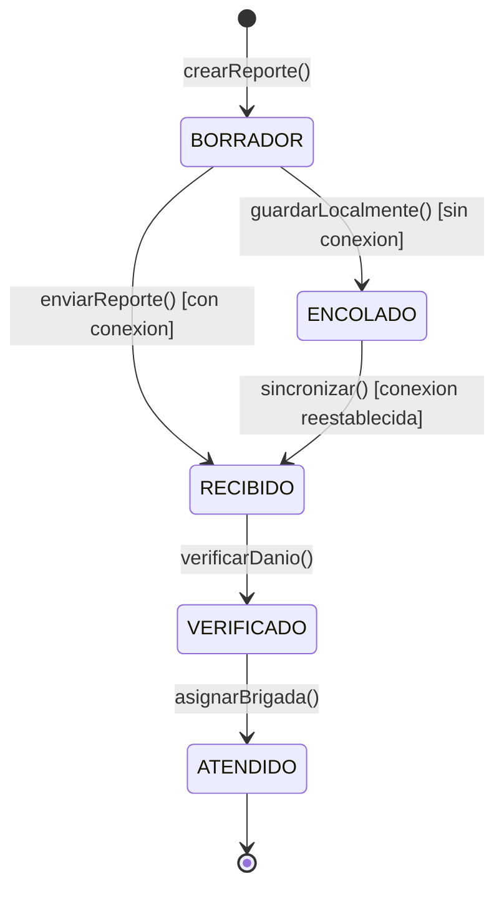
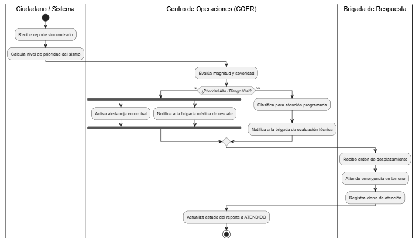
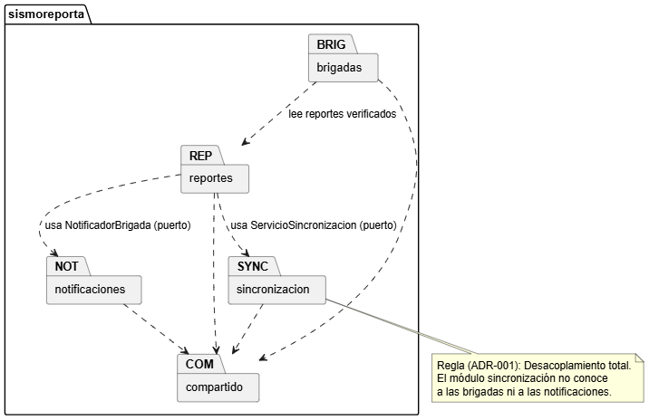
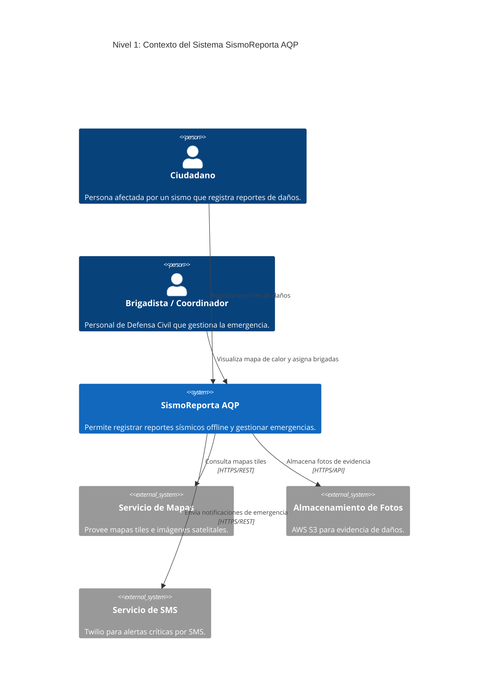

# SismoReporta AQP - Laboratorio 04 y 05: Arquitectura y Diseño UML

**Asignatura**: Construcción de Software (2026-B)  
**Escuela Profesional de Ingeniería de Sistemas - UNSA**

## Integrantes (Grupo XX)
| Nombre | Rol en el laboratorio |
|---|---|
| Adrian Viviano | Diagramador (Mermaid / PlantUML) |
| Adrian Viviano | Redactor de ADRs y drivers |
| Adrian Viviano | Verificador de IA y Script Python Diagrams |

## Caso Elegido: SismoReporta AQP
Plataforma de reporte ciudadano de daños tras un sismo en Arequipa para apoyar a Defensa Civil y brigadistas. Permite registrar reportes con foto y ubicación incluso sin señal de internet, visualizándolos en un mapa de calor priorizado por severidad.
- **Atributo Crítico**: Disponibilidad y resiliencia (20,000 reportes en la primera hora tras el sismo con red móvil congestionada; sincronización offline).

## Arquitectura Elegida

## Diseño UML (Lab 05) - SismoReporta AQP

### 1. Diagrama de Clases (E1)

* [Ver código fuente PlantUML](docs/desing/clases.puml)

### 2. Diagrama de Secuencia - Sincronización Offline (E2)

* [Ver código fuente PlantUML](docs/desing/secuencia-sincronizar-reporte.puml)

### 3. Máquina de Estados - Entidad Reporte (E3)

* [Ver código fuente Mermaid](docs/desing/estados-reporte.mmd)
### 4. Diagrama de Actividades - Asignación de Brigadas (E4)

* [Ver código fuente PlantUML](docs/desing/actividades-asignacion-brigadas.puml)
### 5. Diagrama de Paquetes - Coherencia ADR-001 (E5)

* [Ver código fuente PlantUML](docs/desing/paquetes.puml)
## Documentación de Soporte y Consistencia (E6 - E7)
- **Historia de Usuario:** [HU-08 - Enviar y Sincronizar Reporte Offline](docs/desing/historia.md)
- **Análisis Round-Trip:** [Informe de Ingeniería Directa e Inversa](docs/desing/round-trip.md)
- **Reglas C1-C5:** [Auditoría de Consistencia de Diagramas](docs/desing/consistencia.md)
- **Uso de IA:** [Bitácora de Interacciones y Prompts](docs/design/bitacora-ia.md)
- **Código Fuente:** [Esqueleto de Dominio en Python](src/reportes/dominio.py)
---

## Arquitectura C4 (Lab 06) - SismoReporta AQP

### Diagrama de Contexto (Mermaid C4)

---

## Patrones de Diseño (Lab 07) - SismoReporta AQP

### Resumen de Patrones Aplicados
- **Strategy + Adapter + Factory:** Aislamiento de proveedores de envío SMS (Twilio, SMS Local).
- **State Pattern:** Control del ciclo de vida del reporte (`Borrador` -> `Recibido` -> `Verificado`).
- **Observer Pattern:** Publicación desintegrada hacia brigadas y tableros.
- **Chain of Responsibility + Decorator:** Inferencia de severidad por IA con guardrails y caché local.

### Tabla de Métricas de Refactorización
| Métrica | Antes (`antes/servicio.py`) | Después (`servicio.py`) |
| :--- | :--- | :--- |
| Complejidad Ciclomática Máxima | **14 (Riesgo B)** | **2 (Rango A)** |
| Resultado de Pruebas Automated | 100% Passed (`pytest`) | 100% Passed (`pytest`) |

### Documentación de Diseño y Entregables
- **Olores y Decisiones (E1):** [`docs/design/olores.md`](docs/design/olores.md)
- **Métricas Radon y Trade-Off (E6):** [`docs/design/metricas.md`](docs/design/metricas.md)
- **ADR-005 Patrones de Diseño (E8):** [`docs/architecture/adr/005-patrones-de-diseno.md`](docs/architecture/adr/005-patrones-de-diseno.md)
- **Bitácora de IA Generativa (E7):** [`docs/design/bitacora-ia.md`](docs/design/bitacora-ia.md)

